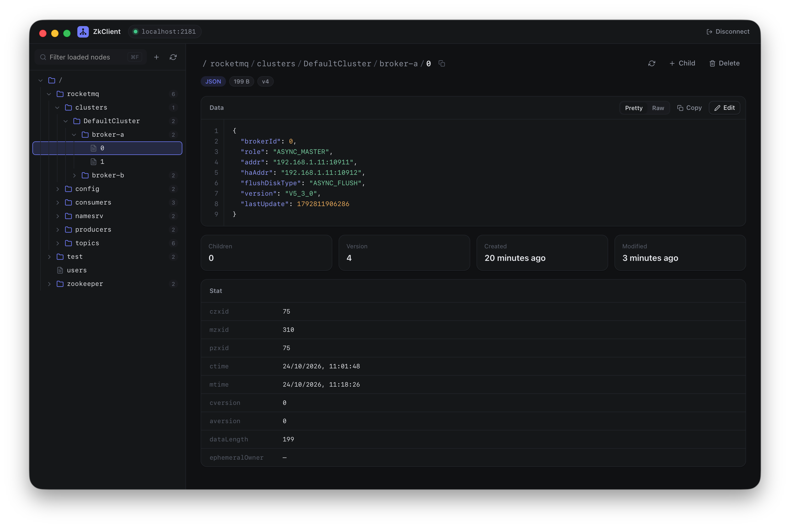

# ZkClient

A lightweight desktop app for browsing and managing Apache ZooKeeper nodes, built with [Wails](https://wails.io) (Go + React). It uses the system WebView instead of bundling Chromium, so the macOS app is under 10 MB.

## Screenshots



## Features

- Connect to any ZooKeeper ensemble (`host:port[,host:port…][/chroot]`), with recent connections remembered
- SSH tunnelling with password or private-key auth
- Lazy-loading tree with child counts, filtering and keyboard navigation
- Syntax highlighting for JSON and `key=value` properties data, with a pretty/raw toggle
- Edit data in place; saves are version-checked so you can't overwrite someone else's change
- Create persistent, ephemeral and sequential nodes; delete recursively
- Full stat view (zxids, versions, timestamps, ephemeral owner session)
- Light and dark themes that follow the system setting

### Keyboard shortcuts

| Shortcut | Action |
| --- | --- |
| `↑` `↓` | Move through the tree |
| `←` `→` | Collapse / expand, or jump to parent / first child |
| `⌘F` | Filter the tree |
| `⌘N` | New node under the selected node |
| `⌘R` | Refresh |
| `⌘S` | Save while editing |
| `Esc` | Cancel editing / close dialogs |

## Development

Prerequisites: Go (version in `go.mod`), Node.js 20+, and the Wails CLI:

```bash
go install github.com/wailsapp/wails/v2/cmd/wails@latest
wails doctor   # checks platform dependencies
```

Run with hot reload:

```bash
wails dev
```

This opens the app window and also serves it at http://localhost:34115, where the Go bindings work from a normal browser and its devtools.

### Project layout

```
main.go, app.go     Wails entry point and the methods bound to the frontend
zk.go               ZooKeeper client (go-zookeeper/zk)
ssh.go              SSH tunnel; ZK connections are dialled through the SSH client
frontend/           React + TypeScript UI (Vite)
frontend/wailsjs/   Generated bindings (regenerated by wails dev/build)
build/              App icon and platform packaging config
```

### Tests

The Go tests run against a real ZooKeeper and are skipped if none is reachable:

```bash
brew install zookeeper && brew services start zookeeper
go test ./...                       # uses localhost:2181
ZK_TEST_ADDR=host:2181 go test ./...
```

Set `ZK_DEBUG=1` to log the ZooKeeper client's connection activity.

## Building

```bash
wails build                              # current platform
wails build -platform darwin/universal   # Intel + Apple Silicon
```

The app is written to `build/bin/`. Windows and Linux builds work too (`wails build -platform windows/amd64`, `linux/amd64`); see the [Wails docs](https://wails.io/docs/gettingstarted/installation#platform-specific-dependencies) for their dependencies.

## Releases

GitHub Actions builds and tests every push and pull request. Pushing a `v*` tag also packages a universal macOS DMG and attaches it to a GitHub release:

```bash
git tag v2.0.0 && git push origin v2.0.0
```

The app version comes from the tag.

## Usage

1. Enter a connection string (default `localhost:2181`). Optionally enable **SSH tunnel**.
2. Click **Connect**.
3. Browse the tree and select a node to view its data and stat.
4. Use **Edit** to change data, **+ Child** to create a node, and **Delete** to remove one.
